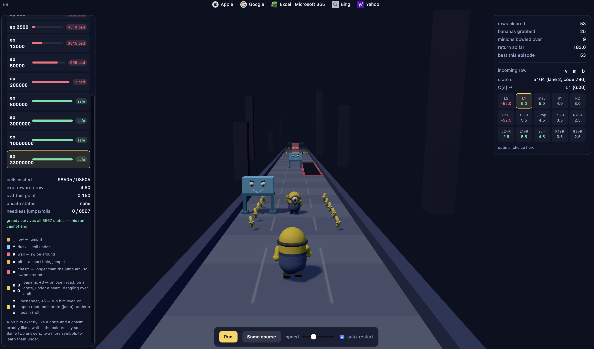

# Minion Rush Agent

A Minion Rush agent built with reinforcement learning (Q-learning), modelling
obstacles, rewards and collection in a hand-built Gymnasium environment,
`MinionRush-v5`.



```bash
python train.py                     # -> minion_q.npy
python evaluate.py                  # trained policy vs. random baseline
python read_q.py                    # print all 98505 cells, check against exact_q
python export_checkpoints.py        # -> web/checkpoints.json
python -m http.server -d web 8777   # visualiser at http://localhost:8777
```

Requires `gymnasium` and `numpy` (`pip install -r requirements.txt`). The
visualiser plays a checkpoint's greedy policy down a generated track — pick an
episode on the left and it runs until it crashes.

## Directory structure

```txt
minion-rush-agent/
├── minion_rush.py          # the environment, plus exact_q
├── train.py                # Q-learning loop -> minion_q.npy
├── evaluate.py             # trained policy vs. random baseline
├── read_q.py               # dump the table, diff against exact_q
├── export_checkpoints.py   # mid-training snapshots -> checkpoints.json
├── minion_q.npy            # the trained Q-table
├── requirements.txt        # pinned deps
├── docs/                   # README images
└── web/                    # browser visualiser
    ├── index.html          # the runner
    └── checkpoints.json    # Q-table snapshots
```

---

## Model Evolution

|                                        | states   | actions | Q-cells   |
| -------------------------------------- | -------- | ------- | --------- |
| v1 — lanes only                        | 21       | 5       | 105       |
| v2 — + jump                            | 78       | 10      | 780       |
| v2 — + roll                            | 189      | 15      | 2835      |
| v3 — + banana                          | 1026     | 15      | 15390     |
| v4 — + pit & chasm                     | 2976     | 15      | 44640     |
| **v5 — + bystander minions (current)** | **6567** | **15**  | **98505** |

## Environment state

- **What one lane can hold**

  Clear, a crate, a beam, or a pit — and each of those four can be carrying a
  **payload**: nothing, a banana, or a bystander minion. So 4 × 3 → **12**,
  minus the one that does not exist — a bystander over a pit has nothing to
  stand on → **11**

  Plus a wall and a chasm. Neither ever carries a payload — you cannot reach
  into a wall, and nothing is collectable over a chasm — so each adds a single
  value rather than a set. 11 + 2 → **13**

- **What a row can hold**

  Three lanes, each picking its own value independently. 13 × 13 × 13 → **2197**

- **Drop the unwinnable rows**

  A row with nothing but walls and chasms in it — can't jump, can't roll,
  nowhere left to swipe to. Two impassable values across three lanes is
  2 × 2 × 2 → **8** such rows. 2197 − 8 → **2189**

- hence, **2189 obstacle states**
- **2189 × 3 = 6567 env states**

## State Encoding

| symbol | what it is                       | how you beat it              | value |
| ------ | -------------------------------- | ---------------------------- | ----- |
| `.`    | clear, nothing there             | just run                     | 0     |
| `_`    | crate, low, on the ground        | jump over it                 | 1     |
| `^`    | beam, overhead                   | roll under it                | 2     |
| `o`    | pit, a short missing tile        | jump over it                 | 3     |
| `b`    | banana, on open ground           | run through it, **+3**       | 4     |
| `B`    | banana, sitting on a crate       | jump over it, **+3**         | 5     |
| `v`    | banana, under a beam             | roll under it, **+3**        | 6     |
| `O`    | banana, dangling over a pit      | jump over it, **+3**         | 7     |
| `m`    | bystander minion, on open ground | run him over, **+5**         | 8     |
| `M`    | bystander minion, on a crate     | jump over it, **+5**         | 9     |
| `w`    | bystander minion, under a beam   | roll under it, **+5**        | 10    |
| `=`    | chasm, a pit longer than the jump | swipe to another lane       | 11    |
| `#`    | wall, floor to ceiling           | swipe to another lane        | 12    |

### Example

Agent in lane 1 + the row ahead is `^ # B` — beam, wall, banana on a crate

#### Encoding

**Idea**

```txt
lane 0 owns 0 – 2188       2189 numbers
lane 1 owns 2189 – 4377    2189 numbers
lane 2 owns 4378 – 6566    2189 numbers
                           ----
                           6567 total
```

```txt
lane 0:      0 + offset     offset = 0..2188   →      0 – 2188
lane 1:   2189 + offset     offset = 0..2188   →   2189 – 4377
lane 2:   4378 + offset     offset = 0..2188   →   4378 – 6566

state = lane × 2189 + offset
```

The offset is a **position in the filtered list**, not the base-13 number the
cells spell. Those are two different things, and confusing them is the easiest
mistake available: the first dropped row is `2013` (`===`), so below that the
two happen to coincide, and above it the index runs behind the raw code.

**Step 1: obtain base-10 offset**

| lane | value | × weight     | =        |
| ---- | ----- | ------------ | -------- |
| 0    | 2     | × 1          | 2        |
| 1    | 12    | × 13         | 156      |
| 2    | 5     | × 169        | 845      |
|      |       | **raw code** | **1003** |

1003 is below the first dropped row, so its position in the filtered list is
also **1003**.

**Step 2: add the player-lane block**

state = 1 × 2189 + 1003 = 3192

#### Decoding

- `ID = 3192`
- 3192 / 2189 = 1 R 1003 ⇒ Agent in lane 1 + offset 1003
- offset 1003 ⇒ raw code `1003` (look it up in the filtered list)
- 1003 / 13^2 = 5 R 158 ⇒ Lane 2 is a banana on a crate `B`
- 158 / 13^1 = 12 R 2 ⇒ Lane 1 is a wall `#`
- 2 / 13^0 = 2 R 0 ⇒ Lane 0 is a beam `^`
- hence `^ # B` with agent in lane 1

## Action space

```txt
offset  0    1    2    3    4
shift  −2   −1    0   +1   +2

Each posture owns a block of 5 — one slot per shift:

GROUND  0 × 5 = 0    →  actions  0 – 4
AIR     1 × 5 = 5    →  actions  5 – 9
ROLL    2 × 5 = 10   →  actions 10 – 14

action = posture × 5 + offset
```

## Reward and punishment

One expression, charged on the single step of the episode:

```py
reward = −SWIPE_COST · |shift|            # movement cost
         − HEIGHT_COST[height]            # posture cost
         + (CRASH if crashed else CLEAR)  # outcome
         + (PAYOUT if collected else 0)   # pickup: banana +3 or minion +5
```

| constant     | value      | what it is                                                                     |
| ------------ | ---------- | ------------------------------------------------------------------------------ |
| `CLEAR`      | **+2.0**   | survived the row                                                               |
| `CRASH`      | **−50.0**  | hit something                                                                  |
| `SWIPE_COST` | **−1.0**   | _per lane_ the swipe intends to cross                                          |
| `AIR_COST`   | **−0.5**   | leaving the ground — jump or roll alike                                        |
| `BANANA`     | **+3.0**   | grabbed a banana — only if you survived the cell it was sitting on             |
| `MINION`     | **+5.0**   | bowled over a bystander — same rule, and never off a crate you just ran into   |

## Six deliberate choices

**Jump and roll cost the same.** `HEIGHT_COST = (0.0, 0.5, 0.5)`. Nothing
prefers one manoeuvre on price, so the obstacle in front is the only thing that
can decide between them. A cheaper roll would teach "roll by default" first and
"when to jump" much later.

**Swipes are charged on intent, not distance.** `|shift|` is the lanes the
swipe _meant_ to cross, before the clip to the track. Swiping left from lane 0
still costs 1 even though you do not move — charging the clipped distance would
make a wasted swipe free.

**Restraint comes from cost, not punishment.** There is no obstacle whose
correct answer is "do nothing". Instead, on a clear cell the grounded action
beats _both_ airborne twins by exactly `AIR_COST`:

```txt
CLEAR:  stay +2.0 | jump +1.5 | roll +1.5   -> stay
LOW:    stay −50  | jump +1.5 | roll −50    -> jump
DUCK:   stay −50  | jump −50  | roll +1.5   -> roll
PIT:    stay −50  | jump +1.5 | roll −50    -> jump      (same row as LOW)
CHASM:  every posture −50                   -> swipe out, at the right height
WALL:   every posture −50                   -> swipe out, at the right height

b:      stay +5.0 | jump +4.5 | roll +4.5   -> stay, and take it
B:      stay −50  | jump +4.5 | roll −50    -> jump, and take it
v:      stay −50  | jump −50  | roll +4.5   -> roll, and take it
O:      stay −50  | jump +4.5 | roll −50    -> jump, and take it

m:      stay +7.0 | jump +6.5 | roll +6.5   -> stay, and take him
M:      stay −50  | jump +6.5 | roll −50    -> jump, and take him
w:      stay −50  | jump −50  | roll +6.5   -> roll, and take him
```

The duplicated rows are the point rather than an oversight — `PIT` reads
identically to `LOW` and `CHASM` to `WALL`, which is exactly why the two new
symbols cost states without buying behaviour.

**A banana is worth more than a cleared row.** `BANANA = +3.0`, and it is
collected at any height — land in the lane, survive, take it. So a banana never
changes _which_ posture a cell wants, only whether that cell is worth
travelling to, which puts the entire new decision on the swipe axis. A detour
pays when `BANANA > SWIPE_COST × lanes + HEIGHT_COST` — so **> 1.5** one lane
out and **> 2.5** two lanes out:

```txt
banana underfoot, clear ground    +2 +3         = +5.0   <- the ceiling
banana underfoot, under a beam    +2 +3 −0.5    = +4.5
banana one lane over, on a crate  +2 +3 −1 −0.5 = +3.5
banana two lanes over, clear      +2 +3 −2      = +3.0   <- now beats
banana two lanes over, beam       +2 +3 −2 −0.5 = +2.5      standing still
nothing at all, stand still       +2            = +2.0
```

**This replaced `BANANA = +2.0`, which priced the break-even _at_ two lanes
rather than past it.** At +2 a two-lane grab scored exactly +2.0 against +2.0
for standing still, and any posture cost on top tipped it negative — so the
agent correctly walked past every banana more than one lane away, which read as
indifference to bananas and was really just arithmetic. +3.0 clears the
two-lane bar by 0.5 with a roll or a jump still charged, so the furthest
reachable banana is worth going for while the margin stays thin enough that
nothing is ever worth a crash. The retrain moved 288 states onto a two-lane
banana detour and lifted the converged average reward from **3.12 to 3.44** per
row. At `+1` the agent would never leave its lane for a banana at all.

**A bystander is worth +5, and the number is chosen against the banana rather
than in isolation.** Collected under the same rule — any height, only if you
survived the cell — so again it changes only whether a cell is worth travelling
to. What +5 buys that a bigger number would not is a row where the two prizes
_compete_:

```txt
minion underfoot, clear           +2 +5         = +7.0   <- the new ceiling
minion one lane over, on a crate  +2 +5 −1 −0.5 = +5.5
banana underfoot, clear           +2 +3         = +5.0   <- ties with
minion two lanes over, clear      +2 +5 −2      = +5.0      this
minion two lanes over, on a beam  +2 +5 −2 −0.5 = +4.5   <- loses to it
```

Two lanes of swipe plus a posture costs 2.5, and the gap between the payloads
is only 2.0 — so the furthest, awkwardest bystander is correctly left standing.
The converged table has **40 states** where taking the minion is strictly worse
than taking a nearer banana, and **80** where the two tie exactly. At +6 every
reachable bystander would be worth chasing and the banana axis would go quiet
whenever one was on the row; at +4 he would win only underfoot or one clear
lane away, and the competition would collapse to a single direction. The whole
point of the version lives in that 0.5.

**For the pit, the size is the mechanic.** A hole is the one obstacle whose
answer is decided by its _length_ rather than its height, so `o` and `=` are
the same hazard at two sizes and the threshold between them is the jump arc
itself — in the visualiser, 13 world units of airborne distance, against a pit
of 6 and a chasm of 18. Nothing else in the model needed a second value of the
same obstacle; this one does, because "can I clear it?" is a question about how
far the jump reaches. The honest consequence is the one in the encoding section
above: both sizes land on hit patterns that already existed, so the version
buys a road rather than a lesson.
